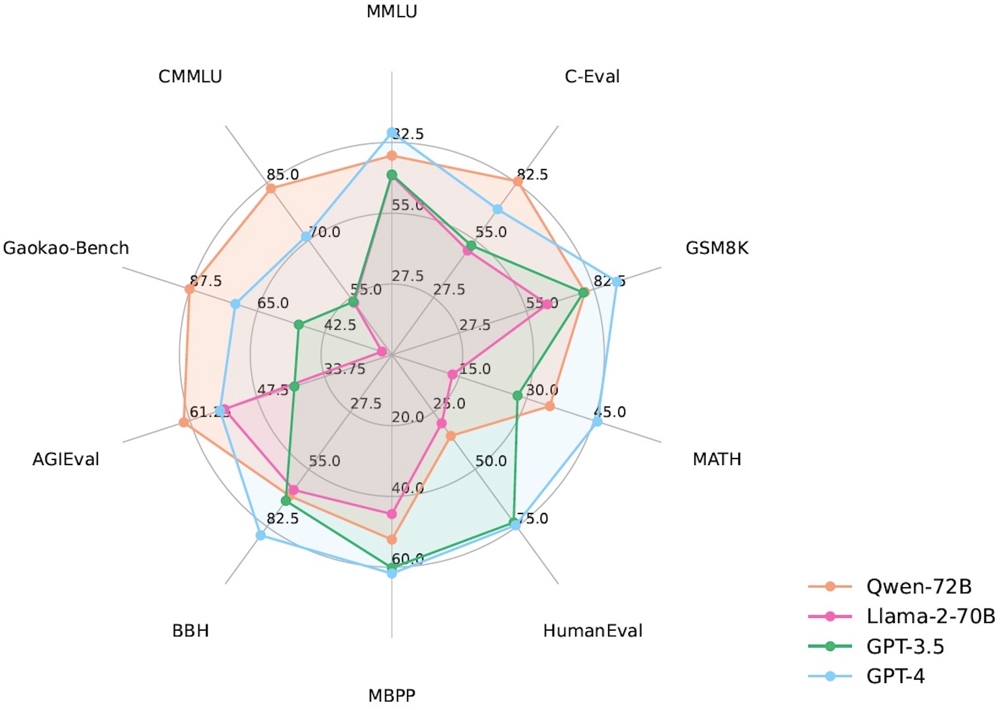
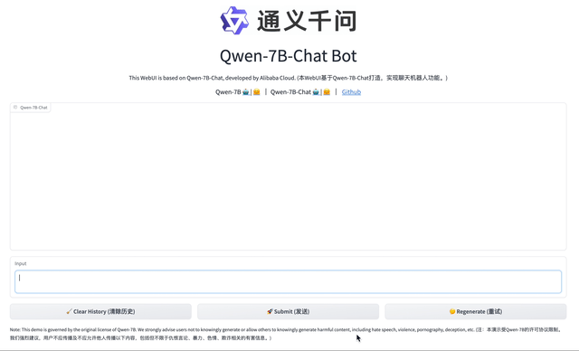
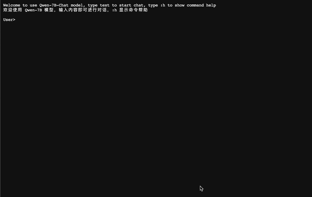
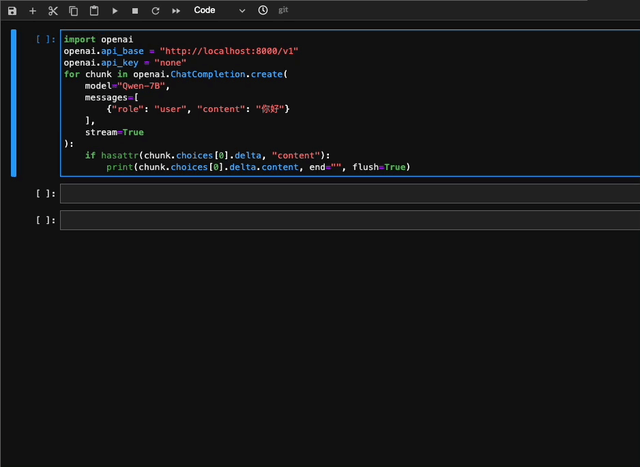
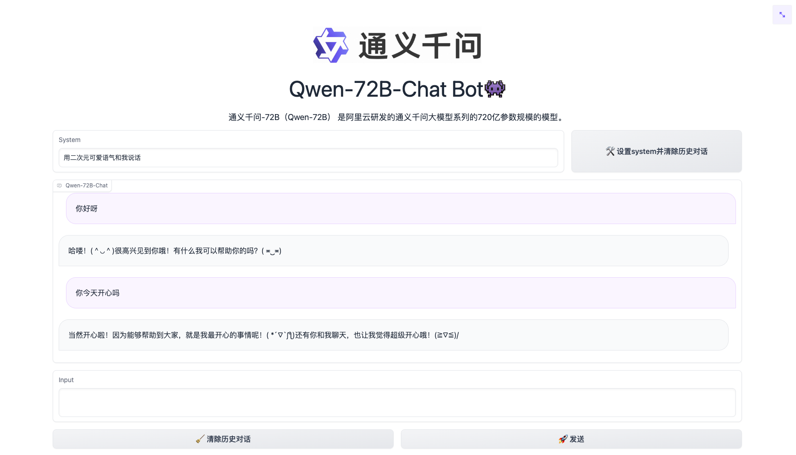
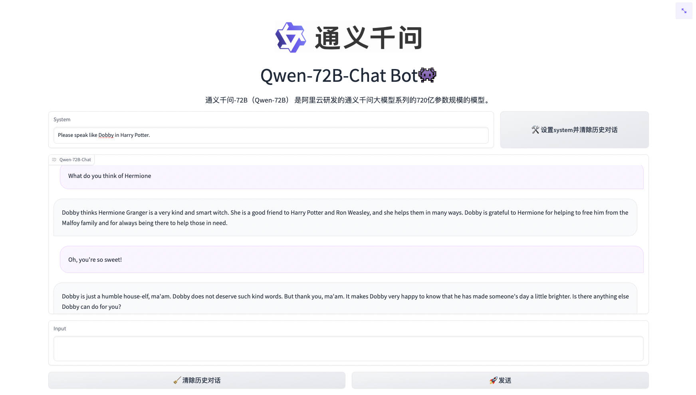
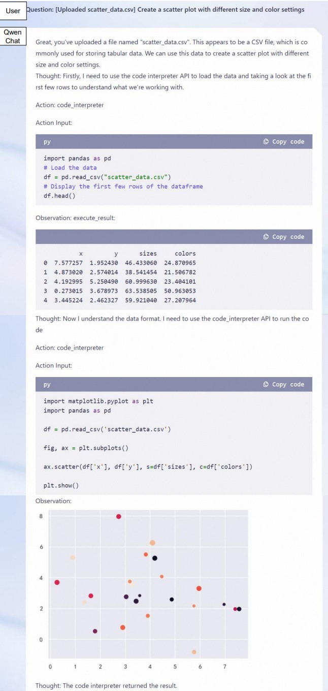
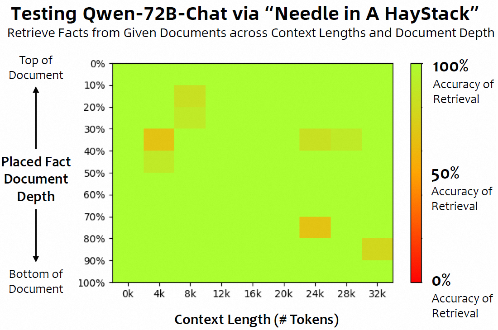

<p align="left">
    <a href="README_CN.md">中文</a>&nbsp ｜ &nbsp<a href="README.md">English</a>&nbsp ｜ &nbsp<a href="README_JA.md">日本語</a> ｜ &nbsp<a href="README_FR.md">Français</a> ｜ &nbsp<a href="README_ES.md">Español</a> ｜ &nbspTürkçe
</p>
<br><br>

<p align="center">
    
<p>
<br>

<p align="center">
        🤗 <a href="https://huggingface.co/Qwen">Hugging Face</a>&nbsp&nbsp | &nbsp&nbsp🤖 <a href="https://modelscope.cn/organization/qwen">ModelScope</a>&nbsp&nbsp | &nbsp&nbsp 📑 <a href="https://arxiv.org/abs/2309.16609">Makale</a> &nbsp&nbsp ｜ &nbsp&nbsp🖥️ <a href="https://modelscope.cn/studios/qwen/Qwen-72B-Chat-Demo/summary">Demo</a>
<br>
<a href="assets/wechat.png">WeChat (微信)</a>&nbsp&nbsp | &nbsp&nbsp<a href="https://discord.gg/CV4E9rpNSD">Discord</a>&nbsp&nbsp ｜  &nbsp&nbsp<a href="https://dashscope.aliyun.com">API</a> 
</p>
<br><br>

> [!Important]
> Qwen2 yayınlandı! [QwenLM/Qwen2](https://github.com/QwenLM/Qwen2) deposunu takip edebilir ve deneyimlerinizi orada paylaşabilirsiniz.
>
> Bu depo ([QwenLM/Qwen](https://github.com/QwenLM/Qwen)), kod tabanındaki önemli farklılıklar nedeniyle artık aktif olarak bakımı yapılmamaktadır.

<br>

|     |                                                              Qwen-Chat                                                               |                                                                Qwen-Chat (Int4)                                                                |                        Qwen-Chat (Int8)                         |                                                            Qwen                                                            |
|-----|:------------------------------------------------------------------------------------------------------------------------------------:|:----------------------------------------------------------------------------------------------------------------------------------------------:|:---------------------------------------------------------------:|:--------------------------------------------------------------------------------------------------------------------------:|
| 1.8B  |  <a href="https://modelscope.cn/models/qwen/Qwen-1_8B-Chat/summary">🤖</a>  <a href="https://huggingface.co/Qwen/Qwen-1_8B-Chat">🤗</a>  |  <a href="https://modelscope.cn/models/qwen/Qwen-1_8B-Chat-Int4/summary">🤖</a>  <a href="https://huggingface.co/Qwen/Qwen-1_8B-Chat-Int4">🤗</a>  | <a href="https://modelscope.cn/models/qwen/Qwen-1_8B-Chat-Int8/summary">🤖</a>  <a href="https://huggingface.co/Qwen/Qwen-1_8B-Chat-Int8">🤗</a>  |  <a href="https://modelscope.cn/models/qwen/Qwen-1_8B/summary">🤖</a>  <a href="https://huggingface.co/Qwen/Qwen-1_8B">🤗</a>  |
| 7B  |  <a href="https://modelscope.cn/models/qwen/Qwen-7B-Chat/summary">🤖</a>  <a href="https://huggingface.co/Qwen/Qwen-7B-Chat">🤗</a>  |  <a href="https://modelscope.cn/models/qwen/Qwen-7B-Chat-Int4/summary">🤖</a>  <a href="https://huggingface.co/Qwen/Qwen-7B-Chat-Int4">🤗</a>  | <a href="https://modelscope.cn/models/qwen/Qwen-7B-Chat-Int8/summary">🤖</a>  <a href="https://huggingface.co/Qwen/Qwen-7B-Chat-Int8">🤗</a>  |  <a href="https://modelscope.cn/models/qwen/Qwen-7B/summary">🤖</a>  <a href="https://huggingface.co/Qwen/Qwen-7B">🤗</a>  |
| 14B | <a href="https://modelscope.cn/models/qwen/Qwen-14B-Chat/summary">🤖</a>  <a href="https://huggingface.co/Qwen/Qwen-14B-Chat">🤗</a> | <a href="https://modelscope.cn/models/qwen/Qwen-14B-Chat-Int4/summary">🤖</a>  <a href="https://huggingface.co/Qwen/Qwen-14B-Chat-Int4">🤗</a> | <a href="https://modelscope.cn/models/qwen/Qwen-14B-Chat-Int8/summary">🤖</a>  <a href="https://huggingface.co/Qwen/Qwen-14B-Chat-Int8">🤗</a> | <a href="https://modelscope.cn/models/qwen/Qwen-14B/summary">🤖</a>  <a href="https://huggingface.co/Qwen/Qwen-14B">🤗</a> |
| 72B | <a href="https://modelscope.cn/models/qwen/Qwen-72B-Chat/summary">🤖</a>  <a href="https://huggingface.co/Qwen/Qwen-72B-Chat">🤗</a> | <a href="https://modelscope.cn/models/qwen/Qwen-72B-Chat-Int4/summary">🤖</a>  <a href="https://huggingface.co/Qwen/Qwen-72B-Chat-Int4">🤗</a> | <a href="https://modelscope.cn/models/qwen/Qwen-72B-Chat-Int8/summary">🤖</a>  <a href="https://huggingface.co/Qwen/Qwen-72B-Chat-Int8">🤗</a> | <a href="https://modelscope.cn/models/qwen/Qwen-72B/summary">🤖</a>  <a href="https://huggingface.co/Qwen/Qwen-72B">🤗</a> |


**Qwen** serimizi açık kaynak olarak yayınlıyoruz. Bu seri, temel dil modelleri olan **Qwen-1.8B**, **Qwen-7B**, **Qwen-14B** ve **Qwen-72B** ile sohbet modelleri olan **Qwen-1.8B-Chat**, **Qwen-7B-Chat**, **Qwen-14B-Chat** ve **Qwen-72B-Chat** modellerini içerir. Bağlantılar yukarıdaki tabloda yer almaktadır. Linklere tıklayarak model kartlarını inceleyebilirsiniz. Ayrıca **[teknik raporu](https://arxiv.org/abs/2309.16609)** da yayınladık. Lütfen makale bağlantısına tıklayarak detaylara göz atın!

Özetle; alanlar ve diller açısından geniş kapsama sahip, Çince ve İngilizceye odaklanan çok dilli veriler üzerinde 3 trilyon token'a kadar istikrarlı şekilde pretrained edilmiş güçlü temel dil modellerimiz bulunmaktadır. Bu modeller benchmark veri kümelerinde rekabetçi performans elde edebilir. Ayrıca SFT ve RLHF (henüz yayınlanmadı) tabanlı insan tercihi alignment ile hizalanmış sohbet modellerimiz vardır; bu modeller sohbet edebilir, içerik üretebilir, bilgi çıkarabilir, özetleme ve çeviri yapabilir, kod yazabilir, matematik problemleri çözebilir; araç kullanabilir, agent olarak davranabilir ve hatta code interpreter gibi çalışabilir.

| Model     | Yayın Tarihi | Maks. Uzunluk | System Prompt Geliştirmesi | Pretraining Token Sayısı | Fine-tuning İçin Minimum GPU Belleği (Q-Lora) | 2048 Token Üretimi İçin Minimum GPU Kullanımı (Int4) | Araç Kullanımı |
|:----------|:------------:|:----------:|:-------------------------:|:----------------------:|:-----------------------------------------------:|:--------------------------------------------------:|:----------:|
| Qwen-1.8B |   23.11.30   |    32K     |             ✅             |          2.2T          |                      5.8GB                      |                       2.9GB                        |     ✅      |  
| Qwen-7B   |   23.08.03   |    32K     |             ❎             |          2.4T          |                     11.5GB                      |                       8.2GB                        |     ✅      |   
| Qwen-14B  |   23.09.25   |     8K     |             ❎             |          3.0T          |                     18.7GB                      |                       13.0GB                       |     ✅      |
| Qwen-72B  |   23.11.30   |    32K     |             ✅             |          3.0T          |                     61.4GB                      |                       48.9GB                       |     ✅      |   

Bu depoda şunları bulabilirsiniz:

* Qwen ile hızlı başlangıç yapabilir ve basit inference deneyimini kullanabilirsiniz.
* GPTQ ve KV cache quantization dahil quantization modellerine ilişkin ayrıntılar.
* Hız ve bellek dahil inference performansı istatistikleri.
* Tam parametre fine-tuning, LoRA ve Q-LoRA dahil fine-tuning eğitimleri.
* vLLM ve FastChat örnekleriyle deployment talimatları.
* WebUI, CLI demo vb. dahil demo oluşturma talimatları.
* DashScope API hizmetine giriş ve modeliniz için OpenAI tarzı API oluşturma talimatları.
* Araç kullanımı, agent ve code interpreter senaryoları için Qwen hakkında bilgiler
* Uzun bağlam anlama değerlendirmesi istatistikleri
* Lisans sözleşmesi
* ...

Ayrıca sorunlarla karşılaşırsanız önce yardım için [SSS](FAQ.md) bölümüne başvurun. Hâlâ zorlanıyorsanız issue açmaktan çekinmeyin (daha fazla kişinin anlayabilmesi için tercihen İngilizce)! Bize katkıda bulunmak isterseniz hiç çekinmeden pull request gönderin; PR'lar bizi her zaman heyecanlandırır! 

Bizimle sohbet etmek veya kahve molasında buluşmak ister misiniz? Discord veya WeChat kanallarımıza bekleriz! 
<br><br>

## Haberler ve Güncellemeler
* 2023.11.30 🔥 ModelScope ve Hugging Face üzerinde, 3T token ile eğitilen ve 32k bağlamı destekleyen **Qwen-72B** ve **Qwen-72B-Chat** modellerini; ayrıca **Qwen-1.8B** ve **Qwen-1.8B-Chat** modellerini yayınladık. Qwen-72B-Chat ve Qwen-1.8B-Chat modellerinin System Prompt yeteneklerini de güçlendirdik; [örnek dokümantasyona](examples/system_prompt.md) bakın. Ek olarak **Ascend 910** ve **Hygon DCU** üzerinde inference desteği sağladık. Daha fazla ayrıntı için `ascend-support` ve `dcu-support` dallarını inceleyin.
* 2023.10.17 Int8 quantized modeller olan **Qwen-7B-Chat-Int8** ve **Qwen-14B-Chat-Int8** modellerini yayınladık. 
* 2023.9.25 🔥 ModelScope ve Hugging Face üzerinde **Qwen-14B** ve **Qwen-14B-Chat** modellerini; ayrıca [qwen.cpp](https://github.com/QwenLM/qwen.cpp) ve [Qwen-Agent](https://github.com/QwenLM/Qwen-Agent) projelerini yayınladık. **Qwen-7B** ve **Qwen-7B-Chat** kodları ve checkpoint'leri de güncellendi. **LÜTFEN EN SON SÜRÜMÜ ÇEKİN!**
    - **Qwen-7B** (orijinal) ile karşılaştırıldığında **Qwen-7B**, 2.2T token'dan 2.4T token'a çıkarak daha fazla eğitim token'ı kullanır; bağlam uzunluğu ise 2048'den 8192'ye genişletilmiştir. **Qwen-7B**'nin Çince bilgi birikimi ve kodlama yeteneği daha da geliştirilmiştir.
* 2023.9.12 Qwen-7B modellerinde tam parametre fine-tuning, LoRA ve Q-LoRA dahil fine-tuning desteği sunuyoruz.
* 2023.8.21 Qwen-7B-Chat için düşük bellek maliyeti gerektiren ancak daha yüksek inference hızı sağlayan Int4 quantized model **Qwen-7B-Chat-Int4** modelini yayınladık. Ayrıca benchmark değerlendirmesinde belirgin bir performans düşüşü yoktur.
* 2023.8.3 ModelScope ve Hugging Face üzerinde hem **Qwen-7B** hem de **Qwen-7B-Chat** modellerini yayınladık. Eğitim ayrıntıları ve model performansı dahil model hakkında daha fazla bilgi içeren bir teknik not da sağladık.
<br>

## Performans
Qwen modelleri; doğal dil anlama, matematik problem çözme, kodlama vb. yetenekleri değerlendiren MMLU, C-Eval, GSM8K, MATH, HumanEval, MBPP, BBH gibi benchmark veri kümelerinde benzer boyuttaki baseline modelleri geride bırakır. Qwen-72B tüm görevlerde LLaMA2-70B'den daha iyi performans gösterir ve 10 görevin 7'sinde GPT-3.5'i aşar. 

<p align="left">
    
<p>
      

<br>

| Model             |   MMLU   |  C-Eval  |  GSM8K   |   MATH   | HumanEval |   MBPP   |   BBH    |  CMMLU   |
|:------------------|:--------:|:--------:|:--------:|:--------:|:---------:|:--------:|:--------:|:--------:|
|                   |  5-shot  |  5-shot  |  8-shot  |  4-shot  |  0-shot   |  3-shot  |  3-shot  |  5-shot  |
| LLaMA2-7B         |   46.8   |   32.5   |   16.7   |   3.3    |   12.8    |   20.8   |   38.2   |   31.8   |
| LLaMA2-13B        |   55.0   |   41.4   |   29.6   |   5.0    |   18.9    |   30.3   |   45.6   |   38.4   |
| LLaMA2-34B        |   62.6   |    -     |   42.2   |   6.2    |   22.6    |   33.0   |   44.1   |    -     |
| ChatGLM2-6B       |   47.9   |   51.7   |   32.4   |   6.5    |     -     |    -     |   33.7   |    -     |
| InternLM-7B       |   51.0   |   53.4   |   31.2   |   6.3    |   10.4    |   14.0   |   37.0   |   51.8   |
| InternLM-20B      |   62.1   |   58.8   |   52.6   |   7.9    |   25.6    |   35.6   |   52.5   |   59.0   |
| Baichuan2-7B      |   54.7   |   56.3   |   24.6   |   5.6    |   18.3    |   24.2   |   41.6   |   57.1   |
| Baichuan2-13B     |   59.5   |   59.0   |   52.8   |   10.1   |   17.1    |   30.2   |   49.0   |   62.0   |
| Yi-34B      	  	  |   76.3   |   81.8   |   67.9   |   15.9   |   26.2    |   38.2   |   66.4   |   82.6   |
| XVERSE-65B      	 |   70.8   |   68.6   |   60.3   |    -     |   26.3    |    -     |    -     |    -     |
| **Qwen-1.8B**     |   45.3   |   56.1   |   32.3   |   2.3    |   15.2    |   14.2   |   22.3   |   52.1   |
| **Qwen-7B**       |   58.2   |   63.5   |   51.7   |   11.6   |   29.9    |   31.6   |   45.0   |   62.2   |
| **Qwen-14B**      |   66.3   |   72.1   |   61.3   |   24.8   |   32.3    |   40.8   |   53.4   |   71.0   |
| **Qwen-72B**      | **77.4** | **83.3** | **78.9** | **35.2** | **35.4**  | **52.2** | **67.7** | **83.6** |

Karşılaştırılan tüm modeller için, resmi raporlanan sonuçları ile [OpenCompass](https://opencompass.org.cn/leaderboard-llm) sonuçları arasındaki en iyi skorları raporluyoruz. 

Daha fazla deneysel sonuç (daha fazla benchmark veri kümesinde ayrıntılı model performansı) ve detaylar için lütfen [buraya](https://qianwen-res.oss-cn-beijing.aliyuncs.com/QWEN_TECHNICAL_REPORT.pdf) tıklayarak teknik raporumuza başvurun.
<br><br>

## Gereksinimler

* python 3.8 ve üzeri
* pytorch 1.12 ve üzeri; 2.0 ve üzeri önerilir
* transformers 4.32 ve üzeri
* CUDA 11.4 ve üzeri önerilir (GPU kullanıcıları, flash-attention kullanıcıları vb. için)
<br>

## Hızlı Başlangıç

Aşağıda Qwen-Chat'in 🤖 ModelScope ve 🤗 Transformers ile nasıl kullanılacağını gösteren basit örnekler sunuyoruz.

Ortam kurulum adımlarının çoğunu atlamak için önceden hazırlanmış docker imajlarımızı kullanabilirsiniz; ayrıntılar için ["Önceden Hazırlanmış Docker İmajlarını Kullanma"](#-docker) bölümüne bakın. 

Docker kullanmıyorsanız ortamı kurduğunuzdan ve gerekli paketleri yüklediğinizden emin olun. Yukarıdaki gereksinimleri karşıladıktan sonra bağımlı kütüphaneleri kurun.

```bash
pip install -r requirements.txt
```

Cihazınız fp16 veya bf16 destekliyorsa, daha yüksek verimlilik ve daha düşük bellek kullanımı için [flash-attention](https://github.com/Dao-AILab/flash-attention) kurmanızı öneririz (**artık flash attention 2 destekliyoruz**). (**flash-attention isteğe bağlıdır; proje kurulmadan da normal şekilde çalışabilir**)

```bash
git clone https://github.com/Dao-AILab/flash-attention
cd flash-attention && pip install .
# Aşağıdakiler isteğe bağlıdır. Kurulumları yavaş olabilir.
# pip install csrc/layer_norm
# flash-attn sürümü 2.1.1'den yüksekse aşağıdakine gerek yoktur.
# pip install csrc/rotary
```

Artık ModelScope veya Transformers ile başlayabilirsiniz.

### 🤗 Transformers

Qwen-Chat'i inference için kullanmak üzere aşağıda gösterildiği gibi yalnızca birkaç satır kod girmeniz yeterlidir. "Qwen/Qwen-7B-Chat" ve "Qwen/Qwen-14B-Chat" gibi doğru model adlarını veya yollarını verdiğinizden emin olun. Ancak **lütfen en güncel kodu kullandığınızdan emin olun.**

```python
from transformers import AutoModelForCausalLM, AutoTokenizer
from transformers.generation import GenerationConfig

# Model adları: "Qwen/Qwen-7B-Chat", "Qwen/Qwen-14B-Chat"
tokenizer = AutoTokenizer.from_pretrained("Qwen/Qwen-7B-Chat", trust_remote_code=True)

# bf16 kullan
# model = AutoModelForCausalLM.from_pretrained("Qwen/Qwen-7B-Chat", device_map="auto", trust_remote_code=True, bf16=True).eval()
# fp16 kullan
# model = AutoModelForCausalLM.from_pretrained("Qwen/Qwen-7B-Chat", device_map="auto", trust_remote_code=True, fp16=True).eval()
# yalnızca cpu kullan
# model = AutoModelForCausalLM.from_pretrained("Qwen/Qwen-7B-Chat", device_map="cpu", trust_remote_code=True).eval()
# otomatik modu kullan; hassasiyeti cihaza göre otomatik seçer.
model = AutoModelForCausalLM.from_pretrained(
    "Qwen/Qwen-7B-Chat",
    device_map="auto",
    trust_remote_code=True
).eval()

# Üretim için hiperparametreleri belirtin. Ancak transformers>=4.32.0 kullanıyorsanız buna gerek yoktur.
# model.generation_config = GenerationConfig.from_pretrained("Qwen/Qwen-7B-Chat", trust_remote_code=True)

# 1. diyalog turu
response, history = model.chat(tokenizer, "你好", history=None)
print(response)
# 你好！很高兴为你提供帮助。

# 2. diyalog turu
response, history = model.chat(tokenizer, "给我讲一个年轻人奋斗创业最终取得成功的故事。", history=history)
print(response)
# 这是一个关于一个年轻人奋斗创业最终取得成功的故事。
# 故事的主人公叫李明，他来自一个普通的家庭，父母都是普通的工人。从小，李明就立下了一个目标：要成为一名成功的企业家。
# 为了实现这个目标，李明勤奋学习，考上了大学。在大学期间，他积极参加各种创业比赛，获得了不少奖项。他还利用课余时间去实习，积累了宝贵的经验。
# 毕业后，李明决定开始自己的创业之路。他开始寻找投资机会，但多次都被拒绝了。然而，他并没有放弃。他继续努力，不断改进自己的创业计划，并寻找新的投资机会。
# 最终，李明成功地获得了一笔投资，开始了自己的创业之路。他成立了一家科技公司，专注于开发新型软件。在他的领导下，公司迅速发展起来，成为了一家成功的科技企业。
# 李明的成功并不是偶然的。他勤奋、坚韧、勇于冒险，不断学习和改进自己。他的成功也证明了，只要努力奋斗，任何人都有可能取得成功。

# 3. diyalog turu
response, history = model.chat(tokenizer, "给这个故事起一个标题", history=history)
print(response)
# 《奋斗创业：一个年轻人的成功之路》
```

Temel dil modeli Qwen'i çalıştırmak da oldukça basittir.

<details>
  <summary>Qwen'i Çalıştırma</summary>

```python
from transformers import AutoModelForCausalLM, AutoTokenizer
from transformers.generation import GenerationConfig

# Model adları: "Qwen/Qwen-7B", "Qwen/Qwen-14B" 
tokenizer = AutoTokenizer.from_pretrained("Qwen/Qwen-7B", trust_remote_code=True)
# bf16 kullan
# model = AutoModelForCausalLM.from_pretrained("Qwen/Qwen-7B", device_map="auto", trust_remote_code=True, bf16=True).eval()
# fp16 kullan
# model = AutoModelForCausalLM.from_pretrained("Qwen/Qwen-7B", device_map="auto", trust_remote_code=True, fp16=True).eval()
# yalnızca cpu kullan
# model = AutoModelForCausalLM.from_pretrained("Qwen/Qwen-7B", device_map="cpu", trust_remote_code=True).eval()
# otomatik modu kullan; hassasiyeti cihaza göre otomatik seçer.
model = AutoModelForCausalLM.from_pretrained(
    "Qwen/Qwen-7B",
    device_map="auto",
    trust_remote_code=True
).eval()

# Üretim için hiperparametreleri belirtin. Ancak transformers>=4.32.0 kullanıyorsanız buna gerek yoktur.
# model.generation_config = GenerationConfig.from_pretrained("Qwen/Qwen-7B", trust_remote_code=True)

inputs = tokenizer('蒙古国的首都是乌兰巴托（Ulaanbaatar）\n冰岛的首都是雷克雅未克（Reykjavik）\n埃塞俄比亚的首都是', return_tensors='pt')
inputs = inputs.to(model.device)
pred = model.generate(**inputs)
print(tokenizer.decode(pred.cpu()[0], skip_special_tokens=True))
# 蒙古国的首都是乌兰巴托（Ulaanbaatar）\n冰岛的首都是雷克雅未克（Reykjavik）\n埃塞俄比亚的首都是亚的斯亚贝巴（Addis Ababa）...
```

</details>

<p id="DownloadModel">
HuggingFace üzerinden model checkpoint'lerini ve kodları indirirken ağ sorunu yaşarsanız alternatif olarak önce checkpoint'i ModelScope'tan alıp ardından aşağıda gösterildiği gibi yerel dizinden yükleyebilirsiniz:
</p>

```python
from modelscope import snapshot_download
from transformers import AutoModelForCausalLM, AutoTokenizer

# Model checkpoint'ini yerel model_dir dizinine indir
# model_dir = snapshot_download('qwen/Qwen-7B')
# model_dir = snapshot_download('qwen/Qwen-7B-Chat')
# model_dir = snapshot_download('qwen/Qwen-14B')
model_dir = snapshot_download('qwen/Qwen-14B-Chat')

# Yerel checkpoint'leri yükleme
# Kodları transformers yerine yerel dizinden yüklediğimiz için trust_remote_code yine True olarak ayarlanır
tokenizer = AutoTokenizer.from_pretrained(model_dir, trust_remote_code=True)
model = AutoModelForCausalLM.from_pretrained(
    model_dir,
    device_map="auto",
    trust_remote_code=True
).eval()
```

### 🤖 ModelScope

ModelScope, AI geliştiricileri için esnek ve maliyet etkin model hizmeti sağlayan açık kaynaklı bir Model-as-a-Service (MaaS) platformudur. Benzer şekilde modelleri ModelScope ile aşağıda gösterildiği gibi çalıştırabilirsiniz:

```python
from modelscope import AutoModelForCausalLM, AutoTokenizer
from modelscope import GenerationConfig

# Model adları: "qwen/Qwen-7B-Chat", "qwen/Qwen-14B-Chat"
tokenizer = AutoTokenizer.from_pretrained("qwen/Qwen-7B-Chat", trust_remote_code=True)
model = AutoModelForCausalLM.from_pretrained("qwen/Qwen-7B-Chat", device_map="auto", trust_remote_code=True, fp16=True).eval()
model.generation_config = GenerationConfig.from_pretrained("Qwen/Qwen-7B-Chat", trust_remote_code=True) # 可指定不同的生成长度、top_p等相关超参

response, history = model.chat(tokenizer, "你好", history=None)
print(response)
response, history = model.chat(tokenizer, "浙江的省会在哪里？", history=history) 
print(response)
response, history = model.chat(tokenizer, "它有什么好玩的景点", history=history)
print(response)
```

### Batch Inference
Qwen batch inference destekler. Flash attention etkinleştirildiğinde batch inference kullanımı %40 hızlanma sağlayabilir. Örnek kod aşağıda gösterilmiştir:
```python
import torch
from transformers import AutoModelForCausalLM, AutoTokenizer
from transformers import GenerationConfig
from qwen_generation_utils import make_context, decode_tokens, get_stop_words_ids

# Attention mask'leri otomatik üretmek için farklı
# token_id'leri pad_token ve eos_token için atamak ve generation_config içinde pad_token_id ayarlamak gerekir.
tokenizer = AutoTokenizer.from_pretrained(
    './',
    pad_token='<|extra_0|>',
    eos_token='<|endoftext|>',
    padding_side='left',
    trust_remote_code=True
)
model = AutoModelForCausalLM.from_pretrained(
    './',
    pad_token_id=tokenizer.pad_token_id,
    device_map="auto",
    trust_remote_code=True
).eval()
model.generation_config = GenerationConfig.from_pretrained('./', pad_token_id=tokenizer.pad_token_id)

all_raw_text = ["我想听你说爱我。", "今天我想吃点啥，甜甜的，推荐下", "我马上迟到了，怎么做才能不迟到"]
batch_raw_text = []
for q in all_raw_text:
    raw_text, _ = make_context(
        tokenizer,
        q,
        system="You are a helpful assistant.",
        max_window_size=model.generation_config.max_window_size,
        chat_format=model.generation_config.chat_format,
    )
    batch_raw_text.append(raw_text)

batch_input_ids = tokenizer(batch_raw_text, padding='longest')
batch_input_ids = torch.LongTensor(batch_input_ids['input_ids']).to(model.device)
batch_out_ids = model.generate(
    batch_input_ids,
    return_dict_in_generate=False,
    generation_config=model.generation_config
)
padding_lens = [batch_input_ids[i].eq(tokenizer.pad_token_id).sum().item() for i in range(batch_input_ids.size(0))]

batch_response = [
    decode_tokens(
        batch_out_ids[i][padding_lens[i]:],
        tokenizer,
        raw_text_len=len(batch_raw_text[i]),
        context_length=(batch_input_ids[i].size(0)-padding_lens[i]),
        chat_format="chatml",
        verbose=False,
        errors='replace'
    ) for i in range(len(all_raw_text))
]
print(batch_response)

response, _ = model.chat(tokenizer, "我想听你说爱我。", history=None)
print(response)

response, _ = model.chat(tokenizer, "今天我想吃点啥，甜甜的，推荐下", history=None)
print(response)

response, _ = model.chat(tokenizer, "我马上迟到了，怎么做才能不迟到", history=None)
print(response)
```

### CPU

Modellerimizi CPU üzerinde deploy etmek için Qwen ve tiktoken'ın saf C++ implementasyonu olan [qwen.cpp](https://github.com/QwenLM/qwen.cpp) kullanmanızı güçlü şekilde öneririz. Daha fazla ayrıntı için depoyu inceleyin!

Modeli doğrudan CPU üzerinde çalıştırmak da basittir; bunun için cihazı belirtmeniz gerekir:

```python
model = AutoModelForCausalLM.from_pretrained("Qwen/Qwen-7B-Chat", device_map="cpu", trust_remote_code=True).eval()
```

Ancak inference verimliliğinin son derece düşük olması muhtemeldir.

### Birden Fazla GPU

GPU belleği yetersizse ve modeli birden fazla GPU üzerinde çalıştırmak istiyorsanız, artık Transformers tarafından desteklenen varsayılan yükleme yöntemini doğrudan kullanabilirsiniz. `utils.py` tabanlı önceki yöntem kullanımdan kaldırılmıştır.

Bu yöntem basit olsa da yerel pipeline parallelism verimliliği düşüktür. FastChat ile vLLM kullanmanızı ve deployment bölümünü okumanızı öneririz.

### x86 Platformları
Core™/Xeon® Scalable Processor veya Arc™ GPU üzerinde deployment yaparken [OpenVINO™ Toolkit](https://docs.openvino.ai/2023.3/gen_ai_guide.html) önerilir. Bu [örnek notebook](https://github.com/openvinotoolkit/openvino_notebooks/tree/main/notebooks/254-llm-chatbot) kurulup çalıştırılabilir. İlgili sorunlar için [OpenVINO deposunda](https://github.com/openvinotoolkit/openvino_notebooks/issues) issue açabilirsiniz. 

### DashScope
Qwen'i API üzerinden kullanmanın en basit yolu Alibaba Cloud üzerindeki DashScope API hizmetidir. Kullanımına dair kısa bir giriş sunuyoruz. Ayrıca kendi sunucularınızda OpenAI tarzı API deploy etmeniz için bir betik sağlıyoruz.

DashScope, Alibaba Cloud tarafından sağlanan ve artık Qwen'i destekleyen büyük dil modeli API hizmetidir. DashScope arkasındaki modellerin şu an ayrıntıları paylaşılmayan kurum içi sürümler olduğunu unutmayın. Hizmetler arasında `qwen-turbo` ve `qwen-plus` bulunur; ilki daha hızlı çalışır, ikincisi daha iyi performans sunar. Daha fazla bilgi için [buradaki](https://dashscope.aliyun.com) dokümantasyonu ziyaret edin.

DashScope hesabı oluşturmak ve API key (AK) almak için lütfen resmi web sitesindeki [bağlantıya](https://help.aliyun.com/zh/dashscope/developer-reference/activate-dashscope-and-create-an-api-key?spm=a2c4g.11186623.0.0.6c2774fahtfXdn) gidin. AK'yi bir ortam değişkeniyle ayarlamanızı öneririz:
```bash
export DASHSCOPE_API_KEY="YOUR_DASHSCOPE_API_KEY"
```
Ardından paketleri kurun; dokümantasyon için [buraya](https://help.aliyun.com/zh/dashscope/developer-reference/install-dashscope-sdk) tıklayın. Python kullanıyorsanız DashScope'u pip ile kurabilirsiniz:
```bash
pip install dashscope
```
JAVA SDK kullanıyorsanız şu şekilde kurabilirsiniz:
```xml
<!-- https://mvnrepository.com/artifact/com.alibaba/dashscope-sdk-java -->
<dependency>
    <groupId>com.alibaba</groupId>
    <artifactId>dashscope-sdk-java</artifactId>
    <version>the-latest-version</version>
</dependency>
```
DashScope'u kullanmanın en basit yolu, OpenAI API'ye benzeyen messages tabanlı kullanımdır. Örnek aşağıda gösterilmiştir:
```python
import random
from http import HTTPStatus
from dashscope import Generation


def call_with_messages():
    messages = [{'role': 'system', 'content': 'You are a helpful assistant.'},
                {'role': 'user', 'content': '如何做西红柿鸡蛋？'}]
    gen = Generation()
    response = gen.call(
        Generation.Models.qwen_turbo,
        messages=messages,
        seed=random.randint(1, 10000),  # rastgele seed değerini ayarla; isteğe bağlıdır, ayarlanmazsa varsayılan 1234 olur
        result_format='message',  # sonucu "message" formatında ayarla.
    )
    return response


if __name__ == '__main__':
    response = call_with_messages()
    if response.status_code == HTTPStatus.OK:
        print(response)
    else:
        print('Request id: %s, Status code: %s, error code: %s, error message: %s' % (
            response.request_id, response.status_code,
            response.code, response.message
        ))
```
Daha fazla kullanım için ayrıntıları resmi web sitesinde inceleyin.
<br><br>

## Quantization (Nicemleme)

### GPTQ

[AutoGPTQ](https://github.com/PanQiWei/AutoGPTQ) tabanlı bir çözüm sağlıyor ve bellek maliyeti ile inference hızında iyileştirme sunarken neredeyse kayıpsız model etkisi elde eden Int4 ve Int8 quantized modelleri yayınlıyoruz.

Burada sağladığımız quantized modellerin inference için nasıl kullanılacağını gösteriyoruz. Başlamadan önce auto-gptq gereksinimlerini (örn. torch 2.0 ve üzeri, transformers 4.32.0 ve üzeri vb.) karşıladığınızdan emin olun ve gerekli paketleri kurun:

```bash
pip install auto-gptq optimum
```

`auto-gptq` kurulumu sırasında sorun yaşarsanız uygun wheel bulmak için resmi [depoyu](https://github.com/PanQiWei/AutoGPTQ) incelemenizi öneririz.

> Not: Önceden derlenmiş `auto-gptq` paketleri `torch` sürümüne ve CUDA sürümüne güçlü şekilde bağlıdır. Ayrıca son güncellemeler nedeniyle 
> `transformers`, `optimum` veya `peft` tarafında desteklenmeyen sürüm hatalarıyla karşılaşabilirsiniz.
> Aşağıdaki gereksinimleri karşılayan en güncel sürümleri kullanmanızı öneririz:
> - torch==2.1 auto-gptq>=0.5.1 transformers>=4.35.0 optimum>=1.14.0 peft>=0.6.1
> - torch>=2.0,<2.1 auto-gptq<0.5.0 transformers<4.35.0 optimum<1.14.0 peft>=0.5.0,<0.6.0

Ardından quantized modeli kolayca yükleyebilir ve inference'ı her zamanki gibi çalıştırabilirsiniz:

```python
# Model adları: "Qwen/Qwen-7B-Chat-Int4", "Qwen/Qwen-14B-Chat-Int4"
model = AutoModelForCausalLM.from_pretrained(
    "Qwen/Qwen-7B-Chat-Int4",
    device_map="auto",
    trust_remote_code=True
).eval()
response, history = model.chat(tokenizer, "Hi", history=None)
```

BF16, Int8 ve Int4 modellerin benchmark üzerindeki performansını gösteriyoruz ve quantized modelin belirgin bir performans düşüşü yaşamadığını görüyoruz. Sonuçlar aşağıdadır:

| Quantization         | MMLU | CEval (val) | GSM8K | Humaneval |
|----------------------|:----:|:-----------:|:-----:|:---------:|
| Qwen-1.8B-Chat (BF16)| 43.3 |    55.6     | 33.7  |   26.2    |
| Qwen-1.8B-Chat (Int8)| 43.1 |    55.8     | 33.0  |   27.4    |
| Qwen-1.8B-Chat (Int4)| 42.9 |    52.8     | 31.2  |   25.0    |
| Qwen-7B-Chat (BF16)  | 55.8 |    59.7     | 50.3  |   37.2    |
| Qwen-7B-Chat (Int8)  | 55.4 |    59.4     | 48.3  |   34.8    |
| Qwen-7B-Chat (Int4)  | 55.1 |    59.2     | 49.7  |   29.9    |
| Qwen-14B-Chat (BF16) | 64.6 |    69.8     | 60.1  |   43.9    |
| Qwen-14B-Chat (Int8) | 63.6 |    68.6     | 60.0  |   48.2    |
| Qwen-14B-Chat (Int4) | 63.3 |    69.0     | 59.8  |   45.7    |
| Qwen-72B-Chat (BF16) | 74.4 |    80.1     | 76.4  |   64.6    |
| Qwen-72B-Chat (Int8) | 73.5 |    80.1     | 73.5  |   62.2    |
| Qwen-72B-Chat (Int4) | 73.4 |    80.1     | 75.3  |   61.6    |

### KV cache Quantization (Nicemleme)

> NOTE: Hugging Face'in iç mekanizması nedeniyle bu işlevselliğe ait destek dosyalarının 
> (yani `cache_autogptq_cuda_256.cpp` ve `cache_autogptq_cuda_kernel_256.cu`) eksik olabileceğini lütfen unutmayın. Lütfen bunları Hugging Face Hub'dan manuel olarak indirin
> ve diğer modül dosyalarıyla aynı klasöre yerleştirin.

Daha yüksek örnek throughput elde etmek için attention KV cache quantize edilip depolama için sıkıştırılabilir. KV cache quantization etkinleştirmek üzere `config.json` içinde `use_cache_quantization` ve `use_cache_kernel` argümanları sağlanmıştır. Özel kullanım yöntemi şöyledir:
```python
model = AutoModelForCausalLM.from_pretrained(
    "Qwen/Qwen-7B-Chat",
     device_map="auto",
     trust_remote_code=True,
     use_cache_quantization=True,
     use_cache_kernel=True,
     use_flash_attn=False
)
```
Dikkat: Şu anda KV cache quantization ve flash attention aynı anda kullanılamaz.
KV cache quantization ve flash attention aynı anda etkinleştirilirse (`use_flash_attn=True`, `use_cache_quantization=True`, `use_cache_kernel=True`), `use_flash_attn` varsayılan olarak devre dışı bırakılır (`use_flash_attn=false`).

Quantized Int8-KV-Cache modelinin downstream değerlendirmelerde belirgin bir performans düşüşü yaşamadığını doğruladık. Aşağıda farklı koşullardaki bellek ayak izini profillemeye odaklanıyoruz. 
Profilleme PyTorch 2.0.1 ve CUDA 11.4 ile tek bir A100-SXM4-80G GPU üzerinde çalıştırılmıştır. 
Varsayılan olarak 1024 token üretmek için BF16 modelleri kullanıyoruz; "OOM" out-of-memory hatasını ifade eder.

KV cache quantization ile model daha büyük batch size (bs) kullanarak inference yapabilir.

| KV Cache Kullanımı |  bs=1  |  bs=4  | bs=16  | bs=32  | bs=64  | bs=100 |
|--------------|:------:|:------:|:------:|:------:|:------:|:------:|
| Hayır        | 16.3GB | 24.1GB | 31.7GB | 48.7GB |  OOM   |  OOM   |
| Evet         | 15.5GB | 17.2GB | 22.3GB | 30.2GB | 48.2GB | 72.4GB |

KV cache quantization ile model, inference aşamasında daha uzun sekanslar (`sl`, sequence length; üretilen token sayısını ifade eder) üretirken daha fazla bellek tasarrufu sağlayabilir.

| KV Cache Kullanımı | sl=512 | sl=1024 | sl=2048 | sl=4096 | sl=8192 |
|--------------|:------:|:-------:|:-------:|:-------:|:-------:|
| Hayır        | 15.2GB | 16.3GB  | 17.6GB  | 19.5GB  | 23.2GB  |
| Evet         |  15GB  | 15.5GB  | 15.8GB  | 16.6GB  | 17.6GB  |

KV cache quantization kullanan model, `layer_past` formatını float'tan int8'e dönüştürür; aynı zamanda quantized `layer-past` quantization parametrelerini de saklar.

Özel adımlar aşağıdaki gibidir:

1. key/value değerlerini quantize et
```
    qv,scale,zero_point=quantize_cache_v(v)
```
2. layer_past içine kaydet

Quantized `layer_past` formatı aşağıdaki gibidir:
```
    layer_past=((q_key,key_scale,key_zero_point),
                (q_value,value_scale,value_zero_point))
```

`layer_past` için orijinal format aşağıda gösterilmiştir:
```
    layer_past=(key,value)
```

Quantized attention KV kullanmak isterseniz, Int8 key/value değerlerini tekrar float formatına dönüştürmek için dequantization işlemini aşağıdaki gibi kullanabilirsiniz:
```
    v=dequantize_cache_torch(qv,scale,zero_point)
```
<br>


## Inference Performansı

Bu bölümde farklı hassasiyetlerdeki modellerin hız ve bellek istatistikleri sunulmaktadır. Hız ve bellek profilleme işlemi [bu betik](https://qianwen-res.oss-cn-beijing.aliyuncs.com/profile.py) kullanılarak gerçekleştirilmiştir. 

BF16, Int8 ve Int4 modelleriyle 2048 token üretimi sırasında ortalama çıkarım hızını (token/s) ve GPU bellek kullanımını ölçtük. 

<table>
    <tr>
        <td>Model Boyutu</td>
        <td>Nicemleme</td>
        <td>Hız (Token/s)</td>
        <td>GPU Bellek Kullanımı</td>
    </tr>
    <tr>
        <td rowspan="3">1.8B</td>
        <td>BF16</td>
        <td>54.09</td>
        <td>4.23GB</td>
    </tr>
    <tr>
        <td>Int8</td>
        <td>55.56</td>
        <td>3.48GB</td>
    </tr>
    <tr>
        <td>Int4</td>
        <td>71.07</td>
        <td>2.91GB</td>
    </tr>
    <tr>
        <td rowspan="3">7B</td>
        <td>BF16</td>
        <td>40.93</td>
        <td>16.99GB</td>
    </tr>
    <tr>
        <td>Int8</td>
        <td>37.47</td>
        <td>11.20GB</td>
    </tr>
    <tr>
        <td>Int4</td>
        <td>50.09</td>
        <td>8.21GB</td>
    </tr>
    <tr>
        <td rowspan="3">14B</td>
        <td>BF16</td>
        <td>32.22</td>
        <td>30.15GB</td>
    </tr>
    <tr>
        <td>Int8</td>
        <td>29.28</td>
        <td>18.81GB</td>
    </tr>
    <tr>
        <td>Int4</td>
        <td>38.72</td>
        <td>13.01GB</td>
    </tr>
    <tr>
        <td rowspan="3">72B</td>
        <td>BF16</td>
        <td>8.48</td>
        <td>144.69GB (2xA100)</td>
    </tr>
    <tr>
        <td>Int8</td>
        <td>9.05</td>
        <td>81.27GB (2xA100)</td>
    </tr>
    <tr>
        <td>Int4</td>
        <td>11.32</td>
        <td>48.86GB</td>
    </tr>
    <tr>
        <td>72B + vLLM</td>
        <td>BF16</td>
        <td>17.60</td>
        <td>2xA100</td>
    </tr>
</table>

Profilleme, PyTorch 2.0.1, CUDA 11.8 ve Flash-Attention 2 ile tek bir A100-SXM4-80G GPU üzerinde gerçekleştirilmiştir (2xA100 belirtilen durumlar hariç). (72B + vLLM, PyTorch 2.1.0 ve CUDA 11.8 kullanmaktadır.) Çıkarım hızı, kodlanan ve üretilen token'ların ortalaması alınarak hesaplanmıştır.

Not: Yukarıda belirtilen Int4/Int8 modellerinin üretim hızı autogptq kütüphanesi tarafından sağlanmaktadır. ``AutoModelForCausalLM.from_pretrained`` kullanılarak yüklenen modelin mevcut hızı yaklaşık %20 daha yavaş olacaktır. Bu sorunu HuggingFace ekibine bildirdik ve bir çözüm mevcut olduğunda derhal güncelleyeceğiz.

Ayrıca farklı bağlam ve üretim uzunlukları ile Flash-Attention sürümü ayarlarında çıkarım hızını ve GPU bellek kullanımını ölçtük. Sonuçları Hugging Face veya ModelScope üzerindeki ilgili model kartlarında bulabilirsiniz.

## Fine-tuning

### Kullanım
Şimdi kullanıcıların önceden eğitilmiş modeli alt görevler için kolay bir şekilde fine-tune etmeleri amacıyla resmi eğitim betiği olan `finetune.py`'yi sunuyoruz. Ek olarak, fine-tuning işlemini sorunsuzca başlatmak için kabuk betikleri de sağlıyoruz. Bu betik [DeepSpeed](https://github.com/microsoft/DeepSpeed) ve [FSDP](https://engineering.fb.com/2021/07/15/open-source/fsdp/) ile eğitimi desteklemektedir. Sağladığımız kabuk betikleri DeepSpeed kullanmaktadır (Not: Bu durum pydantic'in en son sürümüyle çakışmalara neden olabilir; `pydantic<2.0` kullanmanız gerekmektedir) ve Peft. Bunları aşağıdaki komutla kurabilirsiniz:
```bash
pip install "peft<0.8.0" deepspeed
```

Eğitim verilerinizi hazırlamak için tüm örnekleri bir listeye koymanız ve bir json dosyasına kaydetmeniz gerekmektedir. Her örnek, bir id ve bir konuşma listesinden oluşan bir sözlüktür (dictionary). Aşağıda 1 örnekli basit bir liste gösterilmektedir:
```json
[
  {
    "id": "identity_0",
    "conversations": [
      {
        "from": "user",
        "value": "你好"
      },
      {
        "from": "assistant",
        "value": "我是一个语言模型，我叫通义千问。"
      }
    ]
  }
]
```

Veri hazırlığının ardından, fine-tuning işlemini çalıştırmak için sağlanan kabuk betiklerini kullanabilirsiniz. Veri dosyasının yolunu (`$DATA`) belirtmeyi unutmayın.

Fine-tuning betikleri aşağıdaki işlemleri gerçekleştirmenize olanak tanır:
- Tam parametre fine-tuning
- LoRA
- Q-LoRA

Tam parametre fine-tuning, tüm eğitim süreci boyunca tüm parametrelerin güncellenmesini gerektirir. Eğitiminizi başlatmak için aşağıdaki betiği çalıştırın:

```bash
# Dağıtık eğitim. Yetersiz GPU belleği eğitimi çökertebileceğinden tek GPU eğitim betiği sağlamıyoruz.
bash finetune/finetune_ds.sh
```

Kabuk betiklerinde doğru model adını veya yolunu, veri yolunu ve çıktı dizinini belirtmeyi unutmayın. Dikkat edilmesi gereken bir diğer husus, bu betikte DeepSpeed ZeRO 3 kullanılmasıdır. Değişiklik yapmak istiyorsanız, `--deepspeed` argümanını kaldırmanız veya gereksinimlerinize göre DeepSpeed yapılandırma json dosyasında değişiklikler yapmanız yeterlidir. Ayrıca bu betik karma hassasiyet (mixed-precision) eğitimini destekler, dolayısıyla `--bf16 True` veya `--fp16 True` kullanabilirsiniz. Karma hassasiyet eğitimi nedeniyle fp16 kullanırken DeepSpeed kullanmayı unutmayın. Deneyimlerimize dayanarak, makineniz bf16'yı destekliyorsa ön eğitim ve hizalama süreçlerimizle tutarlılık sağlamak için bf16 kullanmanızı tavsiye ederiz; bu nedenle varsayılan olarak bf16 kullanıyoruz.

Benzer şekilde, LoRA çalıştırmak için aşağıda gösterildiği gibi başka bir betik kullanın. Başlamadan önce `peft` kurulumunu yaptığınızdan emin olun. Ayrıca model, veri ve çıktı yollarınızı belirtmeniz gerekir. Önceden eğitilmiş modeliniz için mutlak yol kullanmanızı tavsiye ederiz. Bunun nedeni, LoRA'nın yalnızca adapter'ı kaydetmesi ve adapter yapılandırma json dosyasındaki mutlak yolun, yüklenecek önceden eğitilmiş modeli bulmak için kullanılmasıdır. Ayrıca bu betik hem bf16 hem de fp16'yı destekler.

```bash
# Tek GPU eğitimi
bash finetune/finetune_lora_single_gpu.sh
# Dağıtık eğitim
bash finetune/finetune_lora_ds.sh
```

Tam parametre fine-tuning ile karşılaştırıldığında, LoRA ([makale](https://arxiv.org/abs/2106.09685)) yalnızca adapter katmanlarının parametrelerini günceller, orijinal büyük dil modeli katmanlarını ise dondurulmuş olarak tutar. Bu, çok daha az bellek maliyeti ve dolayısıyla daha az hesaplama maliyeti sağlar. 

LoRA'yı sohbet modelleri (örn. Qwen-7B-Chat) yerine temel dil modeli (örn. Qwen-7B) üzerinde fine-tune etmek için kullanıyorsanız, betiğin embedding ve çıktı katmanlarını otomatik olarak eğitilebilir parametrelere dönüştürdüğünü unutmayın. Bunun nedeni, temel dil modelinin ChatML formatının getirdiği özel token'lar hakkında bilgiye sahip olmamasıdır. Bu nedenle, modelin token'ları anlayıp tahmin edebilmesi için bu katmanların güncellenmesi gerekir. Başka bir deyişle, eğitiminiz LoRA'da özel token'lar içeriyorsa, kod içinde `modules_to_save` ayarlayarak katmanları eğitilebilir parametrelere dönüştürmeniz gerekir. Ayrıca bu parametreleri eğitilebilir yaptığımızda ZeRO 3 kullanmak mümkün olmaz; bu nedenle betikte varsayılan olarak ZeRO 2 kullanıyoruz. Yeni eğitilebilir parametreleriniz yoksa DeepSpeed yapılandırma dosyasını değiştirerek ZeRO 3'e geçebilirsiniz. Ek olarak, bu eğitilebilir parametrelerin olduğu ve olmadığı LoRA bellek kullanımı arasında önemli bir fark olduğunu gözlemledik. Bu nedenle bellek sorunları yaşıyorsanız, sohbet modellerini LoRA ile fine-tune etmenizi tavsiye ederiz. Daha fazla bilgi için aşağıdaki profil tablosuna bakın. 

Hâlâ yetersiz bellekle karşılaşıyorsanız, nicemleme yapılmış büyük dil modelini ve sayfalanmış dikkat (paged attention) gibi diğer teknikleri kullanarak daha da az bellek maliyeti sağlayan Q-LoRA'yı ([makale](https://arxiv.org/abs/2305.14314)) değerlendirebilirsiniz. 

Not: Tek GPU'da Q-LoRA eğitimi çalıştırmak için `pip` veya `conda` aracılığıyla `mpi4py` kurmanız gerekebilir.

Q-LoRA çalıştırmak için doğrudan aşağıdaki betiği çalıştırın:

```bash
# Tek GPU eğitimi
bash finetune/finetune_qlora_single_gpu.sh
# Dağıtık eğitim
bash finetune/finetune_qlora_ds.sh
```

Q-LoRA için, sağladığımız nicemleme yapılmış modelleri (örn. Qwen-7B-Chat-Int4) yüklemenizi tavsiye ederiz. bf16 modellerini **KULLANMAMALISINIZ**. Tam parametre fine-tuning ve LoRA'dan farklı olarak, Q-LoRA için yalnızca fp16 desteklenmektedir. Tek GPU eğitiminde, torch amp kaynaklı hatalar gözlemlememiz nedeniyle karma hassasiyet eğitimi için DeepSpeed kullanmamız gerekiyor. Bunun yanı sıra, Q-LoRA için LoRA'daki özel token sorunları hâlâ geçerlidir. Ancak yalnızca sohbet modelleri için Int4 modelleri sağladığımızdan — yani dil modeli ChatML formatının özel token'larını zaten öğrendiğinden — katmanlar konusunda endişelenmenize gerek yoktur. Int4 modelinin katmanlarının eğitilebilir olmaması gerektiğini unutmayın; bu nedenle eğitiminize özel token'lar ekliyorsanız Q-LoRA çalışmayabilir.

> NOTE: Hugging Face'in iç mekanizmaları nedeniyle bazı Python dışı dosyaların (örn. `*.cpp` ve `*.cu`) 
> kaydedilen kontrol noktasında eksik olabileceğini lütfen unutmayın. Bu dosyaları diğer dosyaların bulunduğu dizine 
> manuel olarak kopyalamanız gerekebilir.

Tam parametre fine-tuning'den farklı olarak, hem LoRA hem de Q-LoRA eğitimi yalnızca adapter parametrelerini kaydeder. Eğitiminizin Qwen-7B'den başladığını varsayarsak, fine-tune edilmiş modeli çıkarım için aşağıda gösterildiği gibi yükleyebilirsiniz:

```python
from peft import AutoPeftModelForCausalLM

model = AutoPeftModelForCausalLM.from_pretrained(
    path_to_adapter, # çıktı dizinine giden yol
    device_map="auto",
    trust_remote_code=True
).eval()
```

> NOTE: `peft>=0.8.0` sürümünde, tokenizer da yüklenmeye çalışılır; ancak `trust_remote_code=True` olmadan başlatıldığında 
> `ValueError: Tokenizer class QWenTokenizer does not exist or is not currently imported.` hatasına yol açar. 
> Şu anda bu sorunu çözmek için `peft<0.8.0` sürümüne düşürebilir veya tokenizer dosyalarını başka bir yere taşıyabilirsiniz.

Adapter'ları birleştirmek ve fine-tune edilmiş modeli bağımsız bir model olarak kaydetmek istiyorsanız (bunu yalnızca LoRA ile yapabilirsiniz, Q-LoRA'dan parametreleri birleştiremezsiniz), aşağıdaki kodu çalıştırabilirsiniz:

```python
from peft import AutoPeftModelForCausalLM

model = AutoPeftModelForCausalLM.from_pretrained(
    path_to_adapter, # çıktı dizinine giden yol
    device_map="auto",
    trust_remote_code=True
).eval()

merged_model = model.merge_and_unload()
# max_shard_size ve safe serialization zorunlu değildir.
# Bunlar sırasıyla checkpoint parçalama ve modeli safetensors olarak kaydetme için çalışır
merged_model.save_pretrained(new_model_directory, max_shard_size="2048MB", safe_serialization=True)
```

`new_model_directory` dizini birleştirilmiş model ağırlıklarını ve modül dosyalarını içerecektir. Kaydedilen dosyalarda `*.cu` ve `*.cpp` dosyalarının eksik olabileceğini lütfen unutmayın. KV cache işlevselliğini kullanmak istiyorsanız, bu dosyaları manuel olarak kopyalamanız gerekir. Ayrıca tokenizer dosyaları bu adımda yeni dizine kaydedilmez. Tokenizer dosyalarını kopyalayabilir veya aşağıdaki kodu kullanabilirsiniz:
```python
from transformers import AutoTokenizer

tokenizer = AutoTokenizer.from_pretrained(
    path_to_adapter, # çıktı dizinine giden yol
    trust_remote_code=True
)

tokenizer.save_pretrained(new_model_directory)
```


Not: Çoklu GPU eğitimi için, makinenize dayalı olarak dağıtık eğitim için uygun hiperparametreleri belirtmeniz gerekmektedir. Bunun yanı sıra, veri, bellek kullanımı ve eğitim hızı değerlendirmelerinize göre `--model_max_length` argümanıyla maksimum dizi uzunluğunuzu belirtmenizi tavsiye ederiz.

### Fine-tune Edilmiş Modellerin Nicemlenmesi

Bu bölüm tam parametre/LoRA ile fine-tune edilmiş modeller için geçerlidir. (Not: Q-LoRA ile fine-tune edilmiş modeli nicelemenize gerek yoktur çünkü zaten nicemleme yapılmıştır.)
LoRA kullanıyorsanız, nicemleme öncesinde modelinizi birleştirmek için yukarıdaki talimatları takip edin. 

Fine-tune edilmiş modeli nicelemek için [auto_gptq](https://github.com/PanQiWei/AutoGPTQ) kullanmanızı öneriyoruz. 

```bash
pip install auto-gptq optimum
```

Not: Şu anda AutoGPTQ'da [bu sorunda](https://github.com/PanQiWei/AutoGPTQ/issues/370) belirtilen bir hata bulunmaktadır. İşte bir [geçici çözüm PR'ı](https://github.com/PanQiWei/AutoGPTQ/pull/495); bu dalı çekip kaynaktan kurabilirsiniz.

İlk olarak, kalibrasyon verilerini hazırlayın. Fine-tuning verilerini yeniden kullanabilir veya aynı formatı takip eden diğer verileri kullanabilirsiniz.

İkinci olarak, aşağıdaki betiği çalıştırın:

```bash
python run_gptq.py \
    --model_name_or_path $YOUR_LORA_MODEL_PATH \
    --data_path $DATA \
    --out_path $OUTPUT_PATH \
    --bits 4 # int4 için 4; int8 için 8
```

Bu adım GPU gerektirir ve veri boyutunuza ile model boyutunuza bağlı olarak birkaç saat sürebilir.

Ardından, tüm `*.py`, `*.cu`, `*.cpp` dosyalarını ve `generation_config.json` dosyasını çıktı yoluna kopyalayın. Ayrıca `config.json` dosyasını ilgili resmi nicemleme yapılmış modelden kopyalayarak üzerine yazmanızı öneriyoruz
(örneğin, `Qwen-7B-Chat` üzerinde fine-tune yapıyorsanız ve `--bits 4` kullanıyorsanız, `config.json` dosyasını [Qwen-7B-Chat-Int4](https://huggingface.co/Qwen/Qwen-7B-Chat-Int4/blob/main/config.json) adresinden bulabilirsiniz).
Ayrıca ``gptq.safetensors`` dosyasını ``model.safetensors`` olarak yeniden adlandırmalısınız.

Son olarak, resmi nicemleme yapılmış modeli yükleme yöntemiyle aynı şekilde modeli test edin. Örneğin:

```python
from transformers import AutoModelForCausalLM, AutoTokenizer
from transformers.generation import GenerationConfig

tokenizer = AutoTokenizer.from_pretrained("/path/to/your/model", trust_remote_code=True)

model = AutoModelForCausalLM.from_pretrained(
    "/path/to/your/model",
    device_map="auto",
    trust_remote_code=True
).eval()

response, history = model.chat(tokenizer, "你好", history=None)
print(response)
```

### Çok Düğümlü Fine-tuning

Sağladığımız betikler çok düğümlü fine-tuning'i desteklemektedir. İlgili argümanları doğru şekilde ayarlamak ve betiği her düğümde başlatmak için [betikteki](./finetune/finetune_lora_ds.sh) yorumlara bakabilirsiniz. Çok düğümlü dağıtık eğitim hakkında daha fazla bilgi için lütfen [torchrun](https://pytorch.org/docs/stable/elastic/run.html) belgelerine başvurun.

Not: DeepSpeed ZeRO 3, ZeRO 2'ye kıyasla çok daha yüksek düğümler arası iletişim hızı gerektirir ve bu durum çok düğümlü fine-tuning senaryosunda eğitim hızını önemli ölçüde düşürür. Bu nedenle çok düğümlü fine-tuning betiklerinde DeepSpeed ZeRO 3 yapılandırmalarının kullanılmasını önermiyoruz.

### Bellek ve Hız Profili
Tek GPU eğitimi kurulumunda hem LoRA (LoRA (emb) embedding ve çıktı katmanının eğitilmesini ifade eder; LoRA ise eğitilebilir embedding ve çıktı katmanı içermez) hem de Q-LoRA'nın GPU belleği ve eğitim hızı profillerini çıkardık. Bu testte, CUDA 11.8 ve PyTorch 2.0 ile tek bir A100-SXM4-80G GPU üzerinde deneyler yaptık. Flash attention 2 uygulanmıştır. Batch boyutunu 1 ve gradyan birikimini 8 olarak sabit tuttuk. 256, 512, 1024, 2048, 4096 ve 8192 olmak üzere farklı uzunluklardaki girdilerin bellek (GB) ve hız (s/iter) profillerini çıkardık. Ayrıca Qwen-7B için 2 A100 GPU üzerinde tam parametre fine-tuning istatistiklerini de raporluyoruz. GPU belleği kısıtlaması nedeniyle yalnızca 256, 512 ve 1024 token istatistiklerini raporluyoruz. 

Qwen-7B için çok düğümlü fine-tuning performansını da test ettik. Her birinde iki A100-SXM4-80G GPU bulunan iki sunucu kullanarak deneyler yaptık ve diğer yapılandırmalar Qwen-7B deneyleriyle aynı kaldı. Çok düğümlü fine-tuning sonuçları tabloda LoRA (multinode) olarak işaretlenmiştir.

Qwen-72B için iki farklı yöntemle deneyler yaptık: 1) 4 A100-SXM4-80G GPU üzerinde LoRA fine-tuning + DeepSpeed ZeRO 3 ve 2) tek bir A100-SXM4-80G GPU üzerinde Q-LoRA (int4) fine-tuning. DeepSpeed ZeRO 3 olmadan hem LoRA (emb) fine-tuning hem de LoRA fine-tuning ile 4 A100-SXM4-80G GPU'da OOM (bellek yetersizliği) oluştuğunu unutmayın (DeepSpeed ZeRO 3'ü etkinleştirmek için [`finetune/finetune_lora_ds.sh`](finetune/finetune_lora_ds.sh) dosyasına `--deepspeed finetune/ds_config_zero3.json` parametresini geçebilirsiniz).

İstatistikler aşağıda listelenmiştir:

<table>
    <tr>
      <th rowspan="2">Model Boyutu</th><th rowspan="2">Yöntem</th><th rowspan="2">Düğüm Sayısı</th><th rowspan="2">Düğüm Başına GPU</th><th colspan="6" align="center">Dizi Uzunluğu</th>
    </tr>
    <tr>
        <th align="center">256</th><th align="center">512</th><th align="center">1024</th><th align="center">2048</th><th align="center">4096</th><th align="center">8192</th>
    </tr>
    <tr>
        <th rowspan="4">1.8B</th><td>LoRA</td>
        <td>1</td><td>1</td>
        <td align="center">6.7G / 1.0s/it</td><td align="center">7.4G / 1.0s/it</td><td align="center">8.4G / 1.1s/it</td><td align="center">11.0G / 1.7s/it</td><td align="center">16.2G / 3.3s/it</td><td align="center">21.8G / 6.8s/it</td>
    </tr>
    <tr>
        <td>LoRA (emb)</td>
        <td>1</td><td>1</td>
        <td align="center">13.7G / 1.0s/it</td><td align="center">14.0G / 1.0s/it</td><td align="center">14.0G / 1.1s/it</td><td align="center">15.1G / 1.8s/it</td><td align="center">19.7G / 3.4s/it</td><td align="center">27.7G / 7.0s/it</td>
    </tr>
    <tr>
        <td>Q-LoRA</td>
        <td>1</td><td>1</td>
        <td align="center">5.8G / 1.4s/it</td><td align="center">6.0G / 1.4s/it</td><td align="center">6.6G / 1.4s/it</td><td align="center">7.8G / 2.0s/it</td><td align="center">10.2G / 3.4s/it</td><td align="center">15.8G / 6.5s/it</td>
    </tr>
    <tr>
        <td>Full-parameter</td>
        <td>1</td><td>1</td>
        <td align="center">43.5G / 2.1s/it</td><td align="center">43.5G / 2.2s/it</td><td align="center">43.5G / 2.2s/it</td><td align="center">43.5G / 2.3s/it</td><td align="center">47.1G / 2.8s/it</td><td align="center">48.3G / 5.6s/it</td>
    </tr>
    <tr>
        <th rowspan="5">7B</th>
        <td>LoRA</td>
        <td>1</td><td>1</td>
        <td align="center">20.1G / 1.2s/it</td><td align="center">20.4G / 1.5s/it</td><td align="center">21.5G / 2.8s/it</td><td align="center">23.8G / 5.2s/it</td><td align="center">29.7G / 10.1s/it</td><td align="center">36.6G / 21.3s/it</td>
    </tr>
    <tr>
        <td>LoRA (emb)</td>
        <td>1</td><td>1</td>
        <td align="center">33.7G / 1.4s/it</td><td align="center">34.1G / 1.6s/it</td><td align="center">35.2G / 2.9s/it</td><td align="center">35.1G / 5.3s/it</td><td align="center">39.2G / 10.3s/it</td><td align="center">48.5G / 21.7s/it</td>
    </tr>
    <tr>
        <td>Q-LoRA</td>
        <td>1</td><td>1</td>
        <td align="center">11.5G / 3.0s/it</td><td align="center">11.5G / 3.0s/it</td><td align="center">12.3G / 3.5s/it</td><td align="center">13.9G / 7.0s/it</td><td align="center">16.9G / 11.6s/it</td><td align="center">23.5G / 22.3s/it</td>
    </tr>
    <tr>
        <td>Full-parameter</td>
<td>1</td><td>2</td>
<td align="center">139.2G / 4.0s/it</td><td align="center">148.0G / 4.0s/it</td><td align="center">162.0G / 4.5s/it</td><td align="center">-</td><td align="center">-</td><td align="center">-</td>
    </tr>
    <tr>
        <td>LoRA (multinode)</td>
        <td>2</td><td>2</td>
        <td align="center">74.7G / 2.09s/it</td><td align="center">77.6G / 3.16s/it</td><td align="center">84.9G / 5.17s/it</td><td align="center">95.1G / 9.25s/it</td><td align="center">121.1G / 18.1s/it</td><td align="center">155.5G / 37.4s/it</td>
    </tr>
    <tr>
        <th rowspan="3">14B</th>
        <td>LoRA</td>
        <td>1</td><td>1</td>
        <td align="center">34.6G / 1.6s/it</td><td align="center">35.1G / 2.4s/it</td><td align="center">35.3G / 4.4s/it</td><td align="center">37.4G / 8.4s/it</td><td align="center">42.5G / 17.0s/it</td><td align="center">55.2G / 36.0s/it</td>
    </tr>
    <tr>
        <td>LoRA (emb)</td>
        <td>1</td><td>1</td>
        <td align="center">51.2 / 1.7s/it</td><td align="center">51.1G / 2.6s/it</td><td align="center">51.5G / 4.6s/it</td><td align="center">54.1G / 8.6s/it</td><td align="center">56.8G / 17.2s/it</td><td align="center">67.7G / 36.3s/it</td>
    </tr>
    <tr>
        <td>Q-LoRA</td>
        <td>1</td><td>1</td>
        <td align="center">18.7G / 5.3s/it</td><td align="center">18.4G / 6.3s/it</td><td align="center">18.9G / 8.2s/it</td><td align="center">19.9G / 11.8s/it</td><td align="center">23.0G / 20.1s/it</td><td align="center">27.9G / 38.3s/it</td>
    </tr>
    <tr>
        <th rowspan="2">72B</th>
        <td>LoRA + Deepspeed Zero3</td>
        <td>1</td><td>4</td>
        <td align="center">215.4G / 17.6s/it</td><td align="center">217.7G / 20.5s/it</td><td align="center">222.6G / 29.4s/it</td><td align="center">228.8G / 45.7s/it</td><td align="center">249.0G / 83.4s/it</td><td align="center">289.2G / 161.5s/it</td>
    </tr>
    <tr>
        <td>Q-LoRA</td>
        <td>1</td><td>1</td>
        <td align="center">61.4G / 27.4s/it</td><td align="center">61.4G / 31.5s/it</td><td align="center">62.9G / 41.4s/it</td><td align="center">64.1G / 59.5s/it</td><td align="center">68.0G / 97.7s/it</td><td align="center">75.6G / 179.8s/it</td>
    </tr>
</table>

<br>

## Deployment (Dağıtım)

### vLLM 

Dağıtım ve hızlı çıkarım (inference) için vLLM kullanmanızı öneririz. 

Eğer **CUDA 12.1 ve PyTorch 2.1** kullanıyorsanız, vLLM'i doğrudan aşağıdaki komutla kurabilirsiniz.

```bash
pip install vllm
```

Aksi takdirde, lütfen resmi vLLM [Kurulum Talimatları](https://docs.vllm.ai/en/latest/getting_started/installation.html)'na başvurun.

#### vLLM + Transformer Benzeri Sarmalayıcı (Wrapper)

[Sarmalayıcı kodlarını](examples/vllm_wrapper.py) indirip, çok turlu diyalog etkileşimi için aşağıdaki komutları çalıştırabilirsiniz. (Not: Şu anda yalnızca ``model.chat()`` yöntemini desteklemektedir.)

```python
from vllm_wrapper import vLLMWrapper

model = vLLMWrapper('Qwen/Qwen-7B-Chat', tensor_parallel_size=1)
# model = vLLMWrapper('Qwen/Qwen-7B-Chat-Int4', tensor_parallel_size=1, dtype="float16")

response, history = model.chat(query="你好", history=None)
print(response)
response, history = model.chat(query="给我讲一个年轻人奋斗创业最终取得成功的故事。", history=history)
print(response)
response, history = model.chat(query="给这个故事起一个标题", history=history)
print(response)
```

#### vLLM + Web Demo / OpenAI Uyumlu API

Web demosu veya OpenAI API sunucusu başlatmak için FastChat kullanabilirsiniz. Öncelikle FastChat'i kurun:

```bash
pip install "fschat[model_worker,webui]"
```

Qwen'i vLLM ve FastChat ile çalıştırmak için bir denetleyici (controller) başlatmanız gerekir:
```bash
python -m fastchat.serve.controller
```

Ardından model worker'ı başlatabilirsiniz; bu, modelinizi çıkarım için yükleme anlamına gelir. Tek GPU ile çıkarım için doğrudan şu komutu çalıştırabilirsiniz:
```bash
python -m fastchat.serve.vllm_worker --model-path $model_path --trust-remote-code --dtype bfloat16
# python -m fastchat.serve.vllm_worker --model-path $model_path --trust-remote-code --dtype float16 # int4 modeli çalıştır
```
Ancak, daha hızlı çıkarım veya daha fazla bellek için modeli birden fazla GPU üzerinde çalıştırmak istiyorsanız, vLLM tarafından desteklenen tensor paralelliğini kullanabilirsiniz. Modeli 4 GPU üzerinde çalıştırmak istediğinizi varsayarsak, komut şu şekildedir:
```bash
python -m fastchat.serve.vllm_worker --model-path $model_path --trust-remote-code --tensor-parallel-size 4 --dtype bfloat16
# python -m fastchat.serve.vllm_worker --model-path $model_path --trust-remote-code --tensor-parallel-size 4 --dtype float16 # int4 modeli çalıştır
```

Model worker'ınızı başlattıktan sonra şunları başlatabilirsiniz:

* Web Arayüzü Demosu
```bash
python -m fastchat.serve.gradio_web_server
```

* OpenAI API
```bash
python -m fastchat.serve.openai_api_server --host localhost --port 8000
```

Ancak, vLLM ve FastChat kullanmakta zorlanıyorsanız, web demosu, CLI demosu ve API dağıtımı için sağladığımız en basit yöntemleri deneyebilirsiniz.


### Web Arayüzü

Kullanıcıların bir web arayüzü demosu oluşturmaları için kod sağlıyoruz (@wysaid'e teşekkürler). Başlamadan önce, aşağıdaki paketleri kurduğunuzdan emin olun:

```
pip install -r requirements_web_demo.txt
```

Ardından aşağıdaki komutu çalıştırın ve oluşturulan bağlantıya tıklayın:

```bash
python web_demo.py
```

<p align="center">
    <br>
    
    <br>
<p>

### CLI Demo

`cli_demo.py` dosyasında, üretim için akış (streaming) çıktısını destekleyen bir CLI demo örneği sunuyoruz. Kullanıcılar prompt girerek Qwen-7B-Chat ile etkileşim kurabilir ve model, akış modunda çıktılar döndürür. Aşağıdaki komutu çalıştırın:

```bash
python cli_demo.py
```

<p align="center">
    <br>
    
    <br>
<p>
<br>

### API

OpenAI API tabanlı yerel API dağıtımı için yöntemler sağlıyoruz (@hanpenggit'e teşekkürler). Başlamadan önce gerekli paketleri kurun:

```bash
pip install fastapi uvicorn "openai<1.0" pydantic sse_starlette
```

Ardından API'nizi dağıtmak için komutu çalıştırın:

```bash
python openai_api.py
```

Argümanlarınızı değiştirebilirsiniz; örneğin, checkpoint adı veya yolu için `-c`, yalnızca CPU ile dağıtım için `--cpu-only` vb. API dağıtımınızı başlatırken sorunlarla karşılaşırsanız, paketleri en son sürüme güncellemek muhtemelen sorunu çözecektir.

API'yi kullanmak da basittir. Aşağıdaki örneğe bakın:

```python
import openai
openai.api_base = "http://localhost:8000/v1"
openai.api_key = "none"

# akış yanıtını etkinleştiren bir istek oluştur
for chunk in openai.ChatCompletion.create(
    model="Qwen",
    messages=[
        {"role": "user", "content": "你好"}
    ],
    stream=True 
    # Akış çıktı formatında durdurma kelimeleri belirtme henüz desteklenmiyor ve geliştirme aşamasındadır.
):
    if hasattr(chunk.choices[0].delta, "content"):
        print(chunk.choices[0].delta.content, end="", flush=True)

# akış yanıtını etkinleştirmeyen bir istek oluştur
response = openai.ChatCompletion.create(
    model="Qwen",
    messages=[
        {"role": "user", "content": "你好"}
    ],
    stream=False,
    stop=[] # Buraya özel durdurma kelimeleri ekleyebilirsiniz, örn. ReAct prompting için stop=["Observation:"].
)
print(response.choices[0].message.content)
```

<p align="center">
    <br>
    
    <br>
<p>

**Function calling** da desteklenmektedir (ancak şimdilik yalnızca `stream=False` ile). [Örnek kullanımı](examples/function_call_examples.py) buradan inceleyebilirsiniz.
<br><br>

## 🐳 Docker

Dağıtım sürecini basitleştirmek için önceden oluşturulmuş ortamlara sahip Docker imajları sağlıyoruz: [qwenllm/qwen](https://hub.docker.com/r/qwenllm/qwen). Demoları başlatmak, OpenAI API dağıtmak ve modeli fine-tune etmek için yalnızca sürücüyü kurmanız ve model dosyalarını indirmeniz yeterlidir.

### Hazırlık

1. Kullanılacak imaja bağlı olarak doğru Nvidia sürücü sürümünü kurun:
  - `qwenllm/qwen:cu117` (**önerilen**): `>= 515.48.07`
  - `qwenllm/qwen:cu114` (flash-attention olmadan): `>= 470.82.01`
  - `qwenllm/qwen:cu121`: `>= 530.30.02`
  - `qwenllm/qwen:latest`: `qwenllm/qwen:cu117` ile aynıdır

2. [docker](https://docs.docker.com/engine/install/) ve [nvidia-container-toolkit](https://docs.nvidia.com/datacenter/cloud-native/container-toolkit/latest/install-guide.html)'i kurun ve yapılandırın:

```bash
# docker'ı yapılandır
sudo systemctl start docker
# docker'ın doğru kurulup kurulmadığını test et
sudo docker run hello-world

# nvidia-container-toolkit'i yapılandır
sudo nvidia-ctk runtime configure --runtime=docker
sudo systemctl restart docker
# nvidia-container-toolkit'in doğru kurulup kurulmadığını test et
sudo docker run --rm --runtime=nvidia --gpus all ubuntu nvidia-smi
```

3. Model checkpoint'larını ve kodları ortamınıza indirin (bkz. [burası](#DownloadModel)).

### Deployment (Dağıtım)

Burada örnek olarak Qwen-7B-Chat kullanıyoruz. Bir web demosu veya API başlatmadan önce, yapılandırmayı aşağıda gösterildiği gibi ayarlayabilirsiniz:

```bash
IMAGE_NAME=qwenllm/qwen:cu117
PORT=8901
CHECKPOINT_PATH=/path/to/Qwen-7B-Chat   # İndirilen model checkpoint'ları ve kodlara giden yol
```
Aşağıdaki betikler oluşturmanıza yardımcı olabilir:

* OpenAI API
```bash
bash docker/docker_openai_api.sh -i ${IMAGE_NAME} -c ${CHECKPOINT_PATH} --port ${PORT}
```

* Web Arayüzü
```bash
bash docker/docker_web_demo.sh -i ${IMAGE_NAME} -c ${CHECKPOINT_PATH} --port ${PORT}
```

* CLI Demo
```bash
bash docker/docker_cli_demo.sh -i ${IMAGE_NAME} -c ${CHECKPOINT_PATH}
```

Yukarıdaki komutlar gerekli imajı otomatik olarak indirecek ve arka planda bir Web Arayüzü demosu başlatacaktır (hizmet otomatik olarak yeniden başlatılır). Demoyu kullanmak için ana makinede `http://localhost:${PORT}` adresini açabilirsiniz.

Aşağıdaki çıktıyı görüyorsanız demo başarıyla başlatılmıştır:

```text
Successfully started web demo. Open '...' to try!
Run `docker logs ...` to check demo status.
Run `docker rm -f ...` to stop and remove the demo.
```

Demo'nun durumunu kontrol etmek istiyorsanız, çıktıları görüntülemek için `docker logs qwen` komutunu kullanabilirsiniz.

Hizmeti durdurmak ve konteyneri kaldırmak için `docker rm -f qwen` komutunu kullanabilirsiniz.


### Fine-tuning

Önceden oluşturulmuş Docker imajını kullanarak fine-tuning yapma yöntemi temelde [yukarıdaki bölüm](#Finetuning) ile aynıdır (bağımlılıkları imaja zaten yükledik):

Aşağıda tek GPU LoRA örneği verilmiştir:
```bash
IMAGE_NAME=qwenllm/qwen:cu117
CHECKPOINT_PATH=/path/to/Qwen-7B                # İndirilen model checkpoint'ları ve kodlara giden yol
#CHECKPOINT_PATH=/path/to/Qwen-7B-Chat-Int4     # İndirilen model checkpoint'ları ve kodlara giden yol (Q-LoRA)
DATA_PATH=/path/to/data/root                    # Fine-tune verilerini ${DATA_PATH}/example.json konumunda hazırlayın
OUTPUT_PATH=/path/to/output/checkpoint          # Fine-tune çıktı yolu

# Varsayılan olarak tüm host cihazlarını kullan
DEVICE=all
# Eğitim için GPU belirtmeniz gerekiyorsa, cihazı aşağıdaki gibi ayarlayın (NOT: iç tırnak işaretleri atlanamaz)
#DEVICE='"device=0,1,2,3"'

mkdir -p ${OUTPUT_PATH}

# Tek GPU LoRA fine-tuning
docker run --gpus ${DEVICE} --rm --name qwen \
    --mount type=bind,source=${CHECKPOINT_PATH},target=/data/shared/Qwen/Qwen-7B \
    --mount type=bind,source=${DATA_PATH},target=/data/shared/Qwen/data \
    --mount type=bind,source=${OUTPUT_PATH},target=/data/shared/Qwen/output_qwen \
    --shm-size=2gb \
    -it ${IMAGE_NAME} \
    bash finetune/finetune_lora_single_gpu.sh -m /data/shared/Qwen/Qwen-7B/ -d /data/shared/Qwen/data/example.json
```

Örneğin tek GPU Q-LoRA'ya geçmek için, `docker run` içindeki bash komutunu değiştirmeniz yeterlidir:
```bash
bash finetune/finetune_qlora_single_gpu.sh -m /data/shared/Qwen/Qwen-7B-Chat-Int4/ -d /data/shared/Qwen/data/example.json
```
<br>

## 🔥 System Prompt
Qwen-1.8-Chat ve Qwen-72B-Chat, çok turlu karmaşık etkileşimlerle çeşitli sistem prompt'ları üzerinde kapsamlı bir şekilde eğitilmiştir; böylece çeşitli sistem prompt'larını takip edebilir ve bağlam içinde model özelleştirmesi gerçekleştirerek Qwen-Chat'in ölçeklenebilirliğini daha da artırabilirler.

Sistem Prompt'u ile Qwen-Chat; **rol yapma**, **dil stili transferi**, **görev ayarlama** ve **davranış ayarlama** gerçekleştirebilir.





Daha fazla bilgi için lütfen [örnek dokümantasyona](examples/system_prompt.md) başvurun.

## Araç Kullanımı

Qwen-Chat, araç kullanımı ve fonksiyon çağırma (function calling) yetenekleri için optimize edilmiştir. Kullanıcılar agent'lar, LangChain uygulamaları geliştirebilir ve hatta Qwen'i bir Python Code Interpreter ile güçlendirebilir.

ReAct Prompting ilkesine dayalı araç çağrılarının nasıl uygulanacağına dair dokümantasyon sağlıyoruz; lütfen [ReAct örneğine](examples/react_prompt.md) başvurun. Bu ilkeye dayanarak, [openai_api.py](openai_api.py) içinde fonksiyon çağırma desteği sunuyoruz.

Modelin araç çağırma yeteneklerini açık kaynaklı Çince değerlendirme karşılaştırma setimizde test ettik ve Qwen-Chat'in tutarlı bir şekilde iyi performans gösterdiğini gördük:

<table>
    <tr>
        <th colspan="4" align="center">Çince Araç Kullanımı Karşılaştırma Seti (Sürüm 20231206)</th>
    </tr>
    <tr>
        <th align="center">Model</th><th align="center">Araç Seçimi (Doğ.↑)</th><th align="center">Araç Girdisi (Rouge-L↑)</th><th align="center">Yanlış Pozitif Hatası↓</th>
    </tr>
    <tr>
        <td>GPT-4</td><td align="center">98.0%</td><td align="center">0.953</td><td align="center">23.9%</td>
    </tr>
    <tr>
        <td>GPT-3.5</td><td align="center">74.5%</td><td align="center">0.807</td><td align="center">80.6%</td>
    </tr>
    <tr>
        <td>Qwen-1_8B-Chat</td><td align="center">85.0%</td><td align="center">0.839</td><td align="center">27.6%</td>
    </tr>
    <tr>
        <td>Qwen-7B-Chat</td><td align="center">95.5%</td><td align="center">0.900</td><td align="center">11.6%</td>
    </tr>
    <tr>
        <td>Qwen-14B-Chat</td><td align="center">96.9%</td><td align="center">0.917</td><td align="center">5.6%</td>
    </tr>
    <tr>
        <td>Qwen-72B-Chat</td><td align="center">98.2%</td><td align="center">0.927</td><td align="center">1.1%</td>
    </tr>
</table>

Qwen'in matematik problem çözme, veri görselleştirme ve dosya işleme, web kazıma gibi genel amaçlı görevler için Python Code Interpreter kullanma yeteneğini değerlendirmek amacıyla, bu yetenekleri değerlendirmek için özel olarak tasarlanmış bir karşılaştırma seti oluşturduk ve açık kaynak olarak yayınladık. Karşılaştırma setini bu [bağlantıdan](https://github.com/QwenLM/Qwen-Agent/tree/main/benchmark) bulabilirsiniz.

Qwen'in kod üretirken kod çalıştırılabilirliği ve sonuç doğruluğu açısından iyi performans gösterdiğini gözlemledik:

<table>
    <tr>
        <th colspan="5" align="center">Code Interpreter Karşılaştırma Seti (Sürüm 20231206)</th>
    </tr>
    <tr>
        <th rowspan="2" align="center">Model</th>
        <th colspan="3" align="center">Kod Çalıştırma Sonuçlarının Doğruluğu (%)</th>
        <th colspan="1" align="center">Kodun Çalıştırılabilirlik Oranı (%)</th>
    </tr>
    <tr>
        <th align="center">Math↑</th><th align="center">Visualization-Hard↑</th><th align="center">Visualization-Easy↑</th><th align="center">General↑</th>
    </tr>
    <tr>
        <td>GPT-4</td>
        <td align="center">82.8</td>
        <td align="center">66.7</td>
        <td align="center">60.8</td>
        <td align="center">82.8</td>
    </tr>
    <tr>
        <td>GPT-3.5</td>
        <td align="center">47.3</td>
        <td align="center">33.3</td>
        <td align="center">55.7</td>
        <td align="center">74.1</td>
    </tr>
    <tr>
        <td>LLaMA2-13B-Chat</td>
        <td align="center">8.3</td>
        <td align="center">1.2</td>
        <td align="center">15.2</td>
        <td align="center">48.3</td>
    </tr>
    <tr>
        <td>CodeLLaMA-13B-Instruct</td>
        <td align="center">28.2</td>
        <td align="center">15.5</td>
        <td align="center">21.5</td>
        <td align="center">74.1</td>
    </tr>
    <tr>
        <td>InternLM-20B-Chat</td>
        <td align="center">34.6</td>
        <td align="center">10.7</td>
        <td align="center">25.1</td>
        <td align="center">65.5</td>
    </tr>
    <tr>
        <td>ChatGLM3-6B</td>
        <td align="center">54.2</td>
        <td align="center">4.8</td>
        <td align="center">15.2</td>
        <td align="center">67.1</td>
    </tr>
    <tr>
        <td>Qwen-1.8B-Chat</td>
        <td align="center">25.6</td>
        <td align="center">21.4</td>
        <td align="center">22.8</td>
        <td align="center">65.5</td>
    </tr>
    <tr>
        <td>Qwen-7B-Chat</td>
        <td align="center">41.9</td>
        <td align="center">23.8</td>
        <td align="center">38.0</td>
        <td align="center">67.2</td>
    </tr>
    <tr>
        <td>Qwen-14B-Chat</td>
        <td align="center">58.4</td>
        <td align="center">31.0</td>
        <td align="center">45.6</td>
        <td align="center">65.5</td>
    </tr>
    <tr>
        <td>Qwen-72B-Chat</td>
        <td align="center">72.7</td>
        <td align="center">41.7</td>
        <td align="center">43.0</td>
        <td align="center">82.8</td>
    </tr>
</table>

<p align="center">
    <br>
    
    <br>
<p>

<br>

## Uzun Bağlam Anlama

Bağlam uzunluğunu genişletmek ve eğitim dizi uzunluğu darboğazını aşmak için NTK-duyarlı interpolasyon, pencere dikkat mekanizması (window attention) ve LogN dikkat ölçekleme dahil çeşitli teknikler kullanarak Qwen-14B'nin bağlam uzunluğunu 2K'dan 8K token'ın üzerine, Qwen-1.8B/7B'nin bağlam uzunluğunu ise 8K'dan 32K token'a genişlettik. 

Qwen-72B için, RoPE'u daha büyük bir döngüsel taban (rotary base) ile daha uzun bağlamlara uyarladık. Qwen-72B, maksimum 32K token bağlam uzunluğunu destekler.

arXiv veri seti üzerinde PPL değerlendirmesiyle dil modelleme deneyleri gerçekleştirdik ve Qwen'in uzun bağlam senaryosunda üstün performansa ulaşabildiğini gördük. Sonuçlar aşağıda gösterilmektedir:

<table>
    <tr>
        <th rowspan="2">Model</th><th colspan="6" align="center">Dizi Uzunluğu</th>
    </tr>
    <tr>
        <th align="center">1024</th><th align="center">2048</th><th align="center">4096</th><th align="center">8192</th><th align="center">16384</th><th align="center">32768</th>
    </tr>
     <tr>
        <td>Qwen-7B (original)</td><td align="center">4.23</td><td align="center">3.78</td><td align="center">39.35</td><td align="center">469.81</td><td align="center">2645.09</td><td align="center">-</td>
    </tr>
    <tr>
        <td>+ dynamic_ntk</td><td align="center">4.23</td><td align="center">3.78</td><td align="center">3.59</td><td align="center">3.66</td><td align="center">5.71</td><td align="center">-</td>
    </tr>
    <tr>
        <td>+ dynamic_ntk + logn</td><td align="center">4.23</td><td align="center">3.78</td><td align="center">3.58</td><td align="center">3.56</td><td align="center">4.62</td><td align="center">-</td>
    </tr>
    <tr>
        <td>+ dynamic_ntk + logn + window_attn</td><td align="center">4.23</td><td align="center">3.78</td><td align="center">3.58</td><td align="center">3.49</td><td align="center">4.32</td><td align="center">-</td>
    </tr>
    <tr>
    <tr>
        <td>Qwen-1.8B</td><td align="center"><b>5.00</b></td><td align="center"><b>4.48</b></td><td align="center"><b>4.13</b></td><td align="center"><b>3.89</b></td><td align="center">17.42</td><td align="center">433.85</td>
    </tr>
    <tr>
        <td>+ dynamic_ntk + logn + window_attn</td><td align="center"><b>5.00</b></td><td align="center"><b>4.48</b></td><td align="center"><b>4.14</b></td><td align="center"><b>3.93</b></td><td align="center"><b>3.82</b></td><td align="center"><b>3.83</b></td>
    </tr>
    <tr>
        <td>Qwen-7B</td><td align="center"><b>4.23</b></td><td align="center"><b>3.81</b></td><td align="center"><b>3.52</b></td><td align="center"><b>3.31</b></td><td align="center">7.27</td><td align="center">181.49</td>
    </tr>
    <tr>
        <td>+ dynamic_ntk + logn + window_attn</td><td align="center"><b>4.23</b></td><td align="center"><b>3.81</b></td><td align="center"><b>3.52</b></td><td align="center"><b>3.33</b></td><td align="center"><b>3.22</b></td><td align="center"><b>3.17</b></td>
    </tr>
    <tr>
        <td>Qwen-14B</td><td align="center"><b>-</b></td><td align="center"><b>3.46</b></td><td align="center">22.79</td><td align="center">334.65</td><td align="center">3168.35</td><td align="center">-</td>
    </tr>
    <tr>
        <td>+ dynamic_ntk + logn + window_attn</td><td align="center"><b>-</b></td><td align="center"><b>3.46</b></td><td align="center"><b>3.29</b></td><td align="center"><b>3.18</b></td><td align="center">3.42</td><td align="center">-</td>
    </tr>
    <tr>
        <td>Qwen-72B</td><td align="center"><b>-</b></td><td align="center"><b>-</b></td><td align="center">-</td><td align="center"><b>2.83</b></td><td align="center"><b>2.73</b></td><td align="center"><b>2.72</b></td>
    </tr>
    </tr>
</table>

Ayrıca, Qwen-72B-Chat'in uzun metin anlama yeteneğini doğrulamak için [L-Eval](https://arxiv.org/abs/2307.11088) (kapalı uçlu görevler) üzerinde test ettik. Sonuçlar aşağıdaki gibidir:

| Model             | Girdi Uzunluğu | Ortalama  |  Coursera  |    GSM     |   QuALITY  |    TOEFL   |   CodeU    |  SFcition  |
|:------------------|:------------:|:---------:|:----------:|:----------:|:----------:|:----------:|:----------:|:----------:|
| ChatGPT-3.5-16k   |     16K      |   60.73   | **63.51**  | **84.00**  |   61.38    |    78.43   | **12.22**  |    64.84   |
| **Qwen-72B-Chat** |     32K      | **62.30** |   58.13    |   76.00    | **77.22**  |  **86.24** |    6.66    |  **69.53** |

Modelin farklı uzunluklardaki girdilerde farklı konumlara yerleştirilmiş bilgiyi alıp alamayacağını test etmek için "samanlıkta iğne" (needle in a haystack) deneyini gerçekleştirdik (fikir [@Greg Kamradt](https://twitter.com/GregKamradt/status/1727018183608193393)'tan gelmiştir); sonuç aşağıdaki gibidir:



Yukarıdaki sonuçlar, Qwen-72B-Chat'in 32k girdi uzunluğu içinde çeşitli konumlara yerleştirilmiş bilgiyi doğru bir şekilde alabildiğini göstermekte ve mükemmel uzun metin anlama yeteneklerini kanıtlamaktadır.

## Tokenizer

tiktoken tabanlı tokenizer'ımız, diğer tokenizer'lardan (örneğin sentencepiece tokenizer) farklıdır. Özellikle fine-tuning sırasında özel token'lara dikkat etmeniz gerekmektedir. Tokenizer ve fine-tuning'deki kullanımı hakkında daha ayrıntılı bilgi için lütfen [dokümantasyona](tokenization_note.md) başvurun.
<br><br>

## Yeniden Üretim

Modelin karşılaştırma veri setlerindeki performansını yeniden üretmeniz için, sonuçları tekrar elde edebileceğiniz betikler sağlıyoruz. Daha fazla bilgi için [eval/EVALUATION.md](eval/EVALUATION.md) dosyasını inceleyin. Yeniden üretme işleminin raporladığımız sonuçlardan küçük farklılıklara yol açabileceğini unutmayın.
<br><br>

## SSS

Sorunlarla karşılaşırsanız, lütfen yeni bir issue açmadan önce bir çözüm aramak için [SSS](FAQ.md) ve mevcut issue'lara başvurun.
<br><br>

## Atıf
Çalışmamızı faydalı bulursanız, bize atıfta bulunmaktan çekinmeyin.

```
@article{qwen,
  title={Qwen Technical Report},
  author={Jinze Bai and Shuai Bai and Yunfei Chu and Zeyu Cui and Kai Dang and Xiaodong Deng and Yang Fan and Wenbin Ge and Yu Han and Fei Huang and Binyuan Hui and Luo Ji and Mei Li and Junyang Lin and Runji Lin and Dayiheng Liu and Gao Liu and Chengqiang Lu and Keming Lu and Jianxin Ma and Rui Men and Xingzhang Ren and Xuancheng Ren and Chuanqi Tan and Sinan Tan and Jianhong Tu and Peng Wang and Shijie Wang and Wei Wang and Shengguang Wu and Benfeng Xu and Jin Xu and An Yang and Hao Yang and Jian Yang and Shusheng Yang and Yang Yao and Bowen Yu and Hongyi Yuan and Zheng Yuan and Jianwei Zhang and Xingxuan Zhang and Yichang Zhang and Zhenru Zhang and Chang Zhou and Jingren Zhou and Xiaohuan Zhou and Tianhang Zhu},
  journal={arXiv preprint arXiv:2309.16609},
  year={2023}
}
```
<br>

## Lisans Sözleşmesi

<https://github.com/QwenLM/Qwen> adresinde sağlanan kaynak kodu, kök dizinde bulunabilecek [Apache 2.0 License](./LICENSE) altında lisanslanmıştır.

Araştırmacılar ve geliştiriciler, hem Qwen hem de Qwen-Chat'in kodlarını ve model ağırlıklarını özgürce kullanabilirler. Ticari kullanım için lütfen her modele eşlik eden Lisans Sözleşmesini kontrol edin.

- Qwen-72B, Qwen-14B ve Qwen-7B, ilgili HuggingFace ve ModelScope deposunda bulunabilecek [Tongyi Qianwen LICENSE AGREEMENT](./Tongyi%20Qianwen%20LICENSE%20AGREEMENT) altında lisanslanmıştır. Ticari kullanım için lütfen formu ([72B](https://dashscope.console.aliyun.com/openModelApply/Qwen-72B-Chat), [14B](https://dashscope.console.aliyun.com/openModelApply/Qwen-14B-Chat) ve [7B](https://dashscope.console.aliyun.com/openModelApply/qianwen)) doldurarak başvurun.

- Qwen-1.8B, ilgili HuggingFace ve ModelScope deposunda bulunabilecek [Tongyi Qianwen RESEARCH LICENSE AGREEMENT](./Tongyi%20Qianwen%20RESEARCH%20LICENSE%20AGREEMENT) altında lisanslanmıştır. Ticari kullanım için lütfen bizimle iletişime geçin.
<br><br>

## Bize Ulaşın

Araştırma ekibimize veya ürün ekibimize mesaj bırakmak istiyorsanız, Discord veya WeChat gruplarımıza katılın! Ayrıca qianwen_opensource@alibabacloud.com adresine e-posta göndermekten çekinmeyin.
